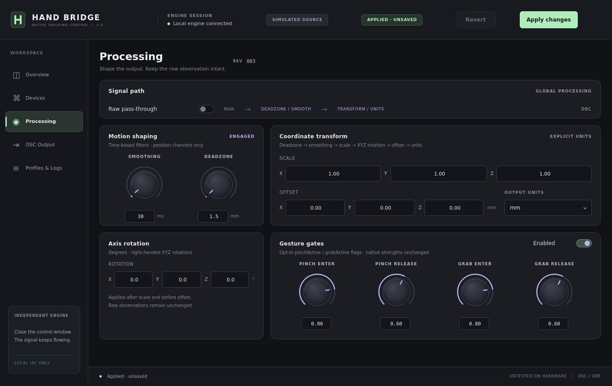

# Hand Bridge 2.0

A native C++20 tracking bridge and modern Qt6 controller for independent Ultraleap
camera streams → OSC/UDP → TouchDesigner on the same Windows PC.

The new **VST-style controller is implemented**: rotary processing controls,
per-camera routing, all supported channel switches, OSC settings, profiles and
live diagnostics. It connects to a separate engine; closing or crashing the
window leaves tracking/OSC running.

**Current new engine source is simulation-only.** The real LeapC adapter, USB /
Hyperion recovery and TouchDesigner receipt remain **UNTESTED ON HARDWARE**.
The original ImGui application/source/README remain available for rollback;
master and handbridge-v2 are unchanged. Read [current state](docs/CURRENT_STATE.md)
for exact verified builds and remaining work.



## Run the native controller

Install Visual Studio2022 Desktop development with C++, CMake3.24+, Python3.9+
(tests only), and official Qt6.8.3 MSVC2022 x64 desktop development files under
Qt's license. In PowerShell, adjust your Qt prefix:

```powershell
$env:Path = "C:\Qt\6.8.3\msvc2022_64\bin;$env:Path"
cmake --preset windows-control -DCMAKE_PREFIX_PATH=C:/Qt/6.8.3/msvc2022_64
cmake --build --preset windows-control --parallel 2
ctest --preset windows-control
.\out\build\windows-control\Debug\handbridge-control.exe --demo
```

Linux with the official Qt desktop package and OpenGL/EGL/xkbcommon development
files:

```sh
cmake --preset control-debug -DCMAKE_PREFIX_PATH=/path/to/Qt/6.8.3/gcc_64
cmake --build --preset control-debug --parallel 2
ctest --preset control-debug
./out/build/control-debug/handbridge-control --demo
```

`--demo` starts a detached simulated engine if needed. Start the controller again
to reconnect. To run the engine explicitly, launch the matching handbridge-engine
with `--simulate`; Ctrl-C shuts down a foreground host. A detached host can be
stopped explicitly using your OS process manager; closing the GUI intentionally
does not stop it. These are developer builds, not a packaged hardware release.

## What the interface controls

- **Overview:** real camera freshness/FPS/counts, raw/processed measured-point
  previews, output rate/errors and engine connection.
- **Devices:** saved serial/alias identity, enabled output, left/right/both routing
  and independent source restart.
- **Processing:** raw bypass, time-based smoothing/deadzone, XYZ scale/rotation/
  offset, output units and optional pinch/grab hysteresis flags.
- **OSC Output:** enable, destination/port, send rate, all14 supported channel
  switches and socket reset. Legacy scalar OSC is the default/only protocol.
- **Profiles & Diagnostics:** apply/save status, atomic named profiles/startup
  restore with backups, bounded real logs and serial-redacted diagnostic export.

Edits are local until **Apply** receives an engine acknowledgement. **Applied**
and **Saved** are different; save a named profile to restore its applied snapshot
on restart. Current processing/channel controls are global, device routing is
per-camera. Per-channel processing overrides, full 3D/all-joint preview, bundles /
OSCv2, installer and real hardware source remain future work.

Default output remains **127.0.0.1:9000**, one float32 per legacy address/datagram,
lowercase hands and raw millimeters. Smoothing/transforms are bypassed by default.
An explicit profile can change processed units; match TouchDesigner scaling.
OS-send success never proves receiver receipt. See [OSC protocol](docs/OSC_PROTOCOL.md)
and [TouchDesigner setup](docs/TOUCHDESIGNER_SETUP.md).

## Headless build without Qt or an SDK

The original SDK-free console build remains available:

```sh
cmake --preset core-debug
cmake --build --preset core-debug --parallel 2
ctest --preset core-debug
./out/build/core-debug/handbridge-engine --simulate --duration-ms 5000
```

Windows uses the corresponding windows-core preset. The plain console host reads
legacy JSON; the Qt IPC host additionally supports [schema2](docs/CONFIG_SCHEMA.md),
profiles and control commands. Working examples:
[legacy](configs/legacy-default.example.json),
[Qt studio default](configs/studio-default.example.json). The older proposed
handbridge.example.json is a design artifact, not the implemented schema.

## Continue with real cameras locally

Follow [Windows local handoff](docs/WINDOWS_LOCAL_HANDOFF.md). Install the official
compatible Ultraleap SDK/runtime; set LEAP_SDK_ROOT to its include/LeapC.h and
lib/x64/LeapC.lib root. The optional windows-legacy preset is the original GUI
reference, not a real-device mode of the new engine. No SDK binary is downloaded,
vendored or redistributed. Hardware integration is the next focused task.

## Documentation

- [Specification](PROJECT_SPEC.md), [plan](PLANS.md), [agent instructions](AGENTS.md)
- [Current state](docs/CURRENT_STATE.md), [handoff](docs/SESSION_HANDOFF.md), [GUI build evidence](docs/reports/GUI_BUILD.md)
- [Architecture](docs/ARCHITECTURE.md), [local IPC](docs/CONTROL_PROTOCOL.md), [configuration](docs/CONFIG_SCHEMA.md), [UI](docs/UI_SPEC.md)
- [Code audit](docs/LEGACY_AUDIT.md), [testing](docs/TESTING.md), [reliability](docs/RELIABILITY.md), [hardware plan](docs/HARDWARE_TEST_PLAN.md)
- [Dependencies/licensing](docs/DEPENDENCIES.md), [decisions](docs/DECISIONS.md), [original README](docs/legacy/README.md)

Build into ignored out/, not the historically tracked build/ directory. Tooling,
local dependency downloads, screenshots-in-progress and scratch files go under work/.
